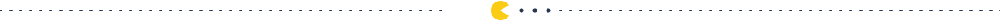
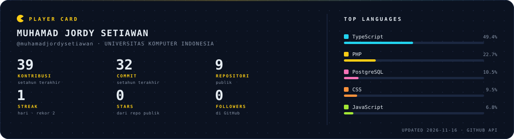

  

  

  

## 👾 `> whoami`

> Mahasiswa **Sistem Informasi** di **Universitas Komputer Indonesia**, Bandung.
> Saya membangun produk web dari hulu ke hilir — merancang antarmuka, menulis frontend, menyusun database, sampai deploy.
> Belakangan saya serius menekuni **AI-assisted development**: memakai AI untuk mempercepat eksekusi, bukan menggantikan pemahaman.

| 🎮 Status | Keterangan |
| :-- | :-- |
| 🏫 Kampus | Universitas Komputer Indonesia (Unikom) |
| 📍 Lokasi | Bandung, Jawa Barat, Indonesia |
| 🎯 Fokus | Full-stack web · AI automation |
| 🧠 Sedang ditekuni | Vibecoding (OpenCode, Claude, Antigravity), MCP, agentic workflow |
| 🧰 Bekal kuliah | C++, Java, JavaScript, PHP, MySQL, Android, Cisco networking, HTML/CSS |
| 🤝 Terbuka untuk | Kolaborasi project, freelance web, diskusi UI/UX |
| 🕹️ Fun fact | Contribution graph di bawah bisa dimainkan — coba scroll ke Arcade Zone |

  

## 🕹️ Skill & Senjata

  

| Lapisan | Teknologi |
| :-- | :-- |
| 🧩 **Frontend** | Next.js · React · Astro · Tailwind CSS · HTML/CSS |
| ⚙️ **Backend** | Node.js · PHP native · REST API · Autentikasi & otorisasi multi-role |
| 🗄️ **Database** | PostgreSQL · MySQL · Supabase · Cloudflare D1 · Drizzle ORM |
| 📱 **Mobile & Jaringan** | Android Studio (Java) · Cisco Packet Tracer |
| 🚀 **Deploy & Tools** | Docker · Cloudflare Workers · Vercel · Git/GitHub · Figma |

  

## 🤖 AI-Assisted Workflow

Saya memakai AI sebagai *pair programmer*: menyusun arsitektur, mempercepat boilerplate, review kode, dan mengotomasi pekerjaan berulang. Setiap output tetap saya baca, uji, dan pertanggungjawabkan.

  

## 🚀 Project Pilihan

<table>
  <tr>
    <td width="50%" valign="top">
      <h3>🎓 <a href="https://github.com/muhamadjordysetiawan/SIGAP-SD">SIGAP SD</a></h3>
      
Platform administrasi sekolah dasar: presensi digital, penilaian <b>Kurikulum Merdeka</b> otomatis, cetak rapor, dan manajemen multi-peran (Admin TU, Kepala Sekolah, Guru).

      

        
        
        
        
        
      

    </td>
    <td width="50%" valign="top">
      <h3>🏍️ <a href="https://github.com/muhamadjordysetiawan/sk-motor-pos">SK Motor POS</a></h3>
      
Kasir all-in-one untuk <b>bengkel motor, cuci steam, dan kafe</b> dalam satu struk transaksi. E-receipt otomatis via WhatsApp, manajemen stok, dan laporan operasional.

      

        
        
        
        
        
      

    </td>
  </tr>
  <tr>
    <td width="50%" valign="top">
      <h3>🛍️ <a href="https://github.com/muhamadjordysetiawan/kolkative-astro-store">Kolkative Store</a></h3>
      
Storefront merchandise <i>headless</i> di edge: Astro + Cloudflare Workers/D1, checkout Mayar API v2, dan harga dihitung ulang di server (zero-trust).

      

        
        
        
        
      

    </td>
    <td width="50%" valign="top">
      <h3>🎭 <a href="https://github.com/muhamadjordysetiawan/Sunshine-Studios">Sunshine Studios</a></h3>
      
Website studio seni dari desain Figma: panel admin untuk CRUD & unggah foto, dua bahasa (ID/EN), responsif, dengan Google Sheets sebagai database.

      

        
        
        
        
      

    </td>
  </tr>
</table>

<b>🧪 Project & eksperimen lainnya</b> (klik untuk buka)

 

| Project | Deskripsi | Stack |
| :-- | :-- | :-- |
| [Nilaionline](https://github.com/muhamadjordysetiawan/Nilaionline_10524155) | Aplikasi pengolahan nilai siswa secara online | PHP · MySQL · CSS |
| [TugasKATI2.github.io](https://github.com/muhamadjordysetiawan/TugasKATI2.github.io) | Arsip tugas kuliah Komputer Aplikasi Teknologi Informasi | HTML · CSS |
| [Tugas-KATI1](https://github.com/muhamadjordysetiawan/Tugas-KATI1) | Tugas UTS semester 2 (arsip, sudah diarsipkan) | HTML |

  

## 📊 Statistik GitHub

  

Kartu di atas digenerate ulang otomatis dari GitHub API oleh GitHub Actions setiap 6 jam.

  

## 👻 Arcade Zone

<i>Pac-Man dan Snake ini digenerate otomatis oleh GitHub Actions dari contribution graph saya, setiap hari.</i>

  

## 📡 Hubungi Saya

<i>Terbuka untuk kolaborasi, freelance, atau sekadar ngobrol soal web dan AI.</i>

  

  

  

<code>muhammadjordysetiawan3882@gmail.com</code>

  

 

  Dibangun dengan kopi, terminal, dan terlalu banyak <code>git push</code> — Bandung, Indonesia.

